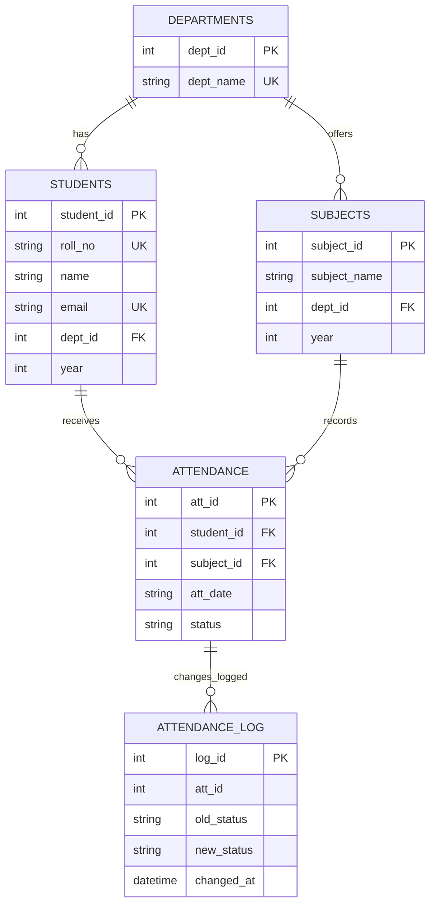

# ER Diagram — College Attendance Management System

This ER diagram matches the **Flask + SQLite** schema in `flask_app/app.py`.

## Relationship notes
- One department can have many students and many subjects.
- One student can have many attendance records; each record belongs to one student and one subject.
- One subject can have many attendance records.
- The `log_attendance_change` trigger records status changes in `attendance_log`.
- `attendance_summary` and `low_attendance_view` are database views, not base entities.

**Schema note:** This diagram represents the Flask/SQLite application. The separate MySQL mini-project schema has different columns and includes a `faculty` table; do not treat the two schemas as identical.
